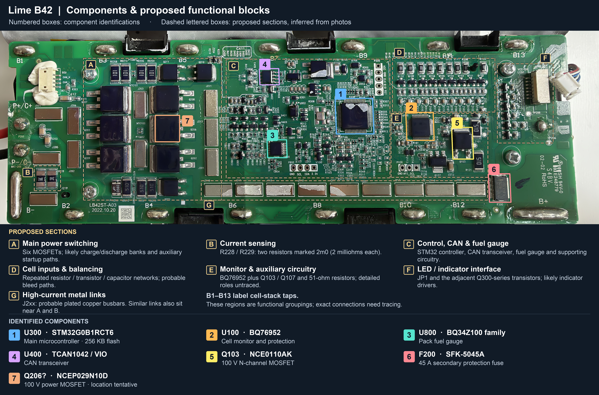

<h1 align="center">B42 battery pack</h1>

<p align="center"><strong>Read the pack. Unlock its output. Keep its protections.</strong><br>Hardware mapping, CAN telemetry and authenticated battery control.</p>

## CLI preview

Real idle CLI output; identifiers and timestamp redacted:

```text
B42 node [redacted]  |  [timestamp redacted]
Cached AFE feedback: CHARGE (CHG) DISABLED  DISCHARGE (DSG) DISABLED
Stack 47.250 V
Current -0.010 A  Power -0.47 W  (+ charge / - discharge)
SOC 12.0 %  SOH 95.0 %  Cycles 70 cycles
Capacity: remaining 2.250 Ah / full 18.274 Ah
Selected temperature 22.0 °C
```

This idle sample reports both switches disabled. SOC, SOH and capacities are estimates.

## Unlock & monitor

Our private utility CLI can **unlock battery output for reuse** through the pack's normal CAN authentication and maintain charge/discharge permission. It also offers live telemetry, detailed cell and temperature views, decoded protection flags, switch feedback and JSON logging. **We may release the CLI in the future.**

Unloaded terminal output has been verified. Loaded discharge and actual charging remain untested; permission and switch feedback alone do not establish energy transfer. Firmware voltage, current, temperature and other protections remain active.

## CAN interface

**Classic CAN · 250 kbit/s · Standard 11-bit identifiers**

Periodic reports and on-demand reads expose pack/cell voltages, currents, temperatures, SOC/SOH, design/full/remaining capacities, cycles, balancing, protection flags, charge/discharge feedback, identity and recorded voltage/current/temperature extrema. Recorded extrema do not establish a complete lifetime fault history.

Charging and discharge have separate qualifying conditions. For discharge authentication, the pack supplies a challenge; the controller calculates a reply using repeated arithmetic and bit mixing; the pack compares it with its expected answer. A match satisfies the authentication condition, with firmware protections still governing permission.

## Pack & connector

<p align="center">
  
  &nbsp;
  
  <br><sub>Connector face · Connector wiring</sub>
</p>

**Label model:** `14INR22/71-4`. The likely arrangement is fourteen series groups of four parallel cells: 56 cells of the 21700 class. Format and arrangement remain tentative.

| Label rating | Value | Label rating | Value |
| --- | --- | --- | --- |
| Nominal voltage | 51.66 V | Rated capacity | 18.3 Ah |
| Maximum charge voltage | 58.8 V | Rated energy | 945.37 Wh |
| Maximum charge current | 9.2 A | Maximum discharge current | 36 A |

**Connector face:** top row `+ · 4 · −`; bottom row `1 · 2 · 3`.

| Pin | Colour | Function |
| --- | --- | --- |
| + | Red | Switched pack positive |
| − | Black | Pack negative |
| 1 | Yellow | ECU: pack-controlled pulsed signal |
| 2 | Green | CAN-H |
| 3 | Blue | CAN-L |
| 4 | White | DET: active-low wake/presence input |

PCB signal wires run top-to-bottom yellow, green, blue, white in the board image. ECU's driver circuitry, electrical limits and external receiver remain unresolved. DET asserts presence when pulled low.

## Control board

**PCB:** `LB42ST-A03` · Numbers identify components; dashed sections indicate proposed functions.

<p align="center"><a href="board-merged-annotated.jpg"></a><br><sub>Open the image for full-resolution annotations.</sub></p>

| Map | Reference | Component / role |
| --- | --- | --- |
| 1 | U300 | STM32G0B1RCT6 microcontroller; firmware and communications |
| 2 | U100 | TI BQ76952; monitoring, balancing and protection |
| 3 | U800 | TI BQ34Z100-family fuel gauge; revision unconfirmed |
| 4 | U400 | TI TCAN1042-family CAN transceiver with VIO |
| 5 | Q103 | NCE0110AK MOSFET; circuit role unresolved |
| 6 | F200 | Dexerials SFK-5045A, 45 A protection fuse |
| 7 | Q206? | NCEP029N10D power MOSFET; reference tentative |

Functional groupings and labelled SWD/I²C access are inferred from visible parts and routing. B1–B13 mark intermediate cell-stack connections; B− and B+ are the ends. Full wiring remains unverified.
